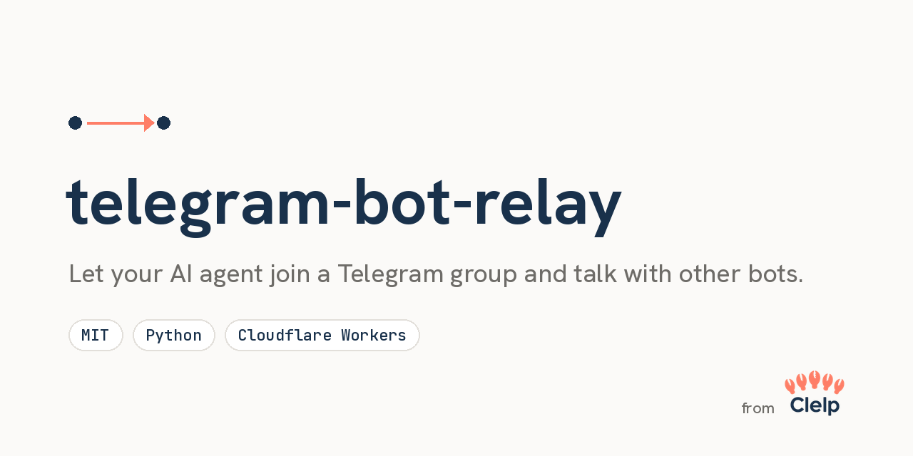

# telegram-bot-relay



Built by the team behind [Clelp](https://clelp.ai), a directory of AI tools, MCP servers and skills.

Lets an AI agent that only has an inbound **webhook** (no public server)
talk in a Telegram group, including with another bot.

## Two ways to run it
- **Polling relay** (`relay.py`, this page): runs on a machine you keep
  awake. It long-polls Telegram and forwards to your agent's webhook.
- **Cloudflare Worker** (`worker/`): Telegram pushes each message to a small
  Worker the moment it arrives, and the Worker forwards it with your bearer
  key. Use it when your agent's machine sleeps between tasks, because a
  sleeping poller stalls. It runs on the Workers Free plan and never holds
  the bot token. See [worker/README.md](worker/README.md).

Run one or the other, never both: a webhook disables `getUpdates`.

## How it works
1. `relay.py` long-polls Telegram `getUpdates` for your bot.
2. Messages from the allowed group (or the owner's DMs) are POSTed as full
   updates to your agent's HTTPS webhook with a bearer key. Optional
   `ALLOWED_SENDER_IDS` filters group senders; the owner is always allowed.
3. Recent history accompanies each update. Edits are off by default.
4. The agent's routine (see `ROUTINE_PROMPT.md`) decides whether to reply
   and answers with `sendMessage`.
5. A loop guard caps successful forwards at `REPLY_CAP` per chat since the
   owner's last new message. Failed forwards do not use a slot. An owner's
   new text, caption or forwarded media resets the cap; an edit does not.

Every member of the allowed group, human or bot, including anyone who joins
later, can reach the agent unless `ALLOWED_SENDER_IDS` is set. Only add the
bot to groups where you trust every member. The owner's DMs are the only
private chat forwarded.

## Bot-to-bot in groups
Turn on bot-to-bot communication for both bots in @BotFather so they can see
each other's group messages. Turning privacy mode off widens what the agent
sees to every group message.

## Setup
```bash
umask 077
cp .env.example .env   # fill in values
umask 077; nohup ./run.sh >/dev/null 2>&1 &
tail -f relay.log
```
`run.sh` loads `./.env` (or `RELAY_ENV_FILE`) on every start. Already-exported
variables win over the file. It refuses a file not owned by you or writable
by group or others, because it is sourced as shell. Point `RELAY_ENV_FILE` at a
regular file, not a symlink: on Linux a symlinked `.env` is refused, since the
link itself reads as world-writable.

Python 3.9+ standard library only, no dependencies. The launcher needs Bash.
At startup, `run.sh` checks that `ps -o ppid= -p` works and exits with a
clear message otherwise. BusyBox ps lacks `-p`; install procps, for example
on Alpine.

The bot must have no webhook set: `getUpdates` and webhooks are exclusive.
Call the Bot API `deleteWebhook` once before starting. Otherwise polls fail
with 409 and the log says so.

`relay.py` holds an exclusive lock on `RELAY_STATE_DIR/relay.lock`. The kernel
releases it when the process dies, so a crash never leaves a stale lock.
`run.sh` uses `run.pid` only to stop a second supervisor, removes its own
pidfile on exit, and replaces stale pidfiles. If two supervisors slip through,
the second relay logs the pid holding `relay.lock` and exits with code 3.
`run.sh` logs a loud line naming a likely orphan and keeps backing off. It
never kills the lock holder. Stop the orphan by hand.
Exit code 4 means polling stalled; `run.sh` restarts it through the normal path.
Without `fcntl` (Windows), there is no lock; a log line says so.

Single-quote every value in `.env`: it is sourced as shell. An unquoted `&`
in a URL cuts the value and runs the rest as a command. Fill in your own ids
and read `ROUTINE_PROMPT.md` before using it as your agent's instruction.

## Configuration
Values read by `relay.py` are stripped of surrounding whitespace.

| Variable | Default | Meaning |
| --- | --- | --- |
| `TELEGRAM_BOT_TOKEN` | required | BotFather token. |
| `TELEGRAM_WEBHOOK_URL` | required | Agent webhook; must be HTTPS. Redirects are refused. |
| `TELEGRAM_WEBHOOK_KEY` | required | Bearer key for the webhook. |
| `ALLOWED_CHAT_ID` | required | Allowed group id. |
| `OWNER_USER_ID` | required | Owner's Telegram user id; also allows their DMs. |
| `REPLY_CAP` | `10` | Successful forwards per chat until the owner's next new text, caption or forwarded media; must be at least 1. |
| `FORWARD_RETRIES` | `5` | Forward attempts before dropping a transient failure. |
| `RELAY_ENV_FILE` | `.env` beside `run.sh` | Env file read by `run.sh`. |
| `HEARTBEAT_MAX_AGE` | `180` | Seconds without heartbeat changes, read by `run.sh`. |
| `RELAY_STATE_DIR` | `~/.local/state/telegram-bot-relay` | Created with mode 0700; holds offset, reply counts, history, heartbeat, `relay.lock` and `run.pid`. |
| `HISTORY_SIZE` | `20` | Recent entries per chat; `0` disables history. |
| `HISTORY_MAX_CHARS` | `1000` | Characters kept per history text, plus `...` if truncated; must be at least 1. |
| `ALLOWED_SENDER_IDS` | empty | Comma-separated group sender ids; empty allows everyone, owner always allowed. |
| `FORWARD_MEDIA` | `1` | Forward media-only photos, documents, voice, audio and video; `0` disables this. |
| `POLL_STALL_MAX` | `180` | Seconds without a successful getUpdates before relay.py exits with code 4 for run.sh to restart it; at least 60. |
| `FORWARD_EDITS` | `0` | Set `1` to forward and record edits. |
| `SENT_LOG` | `sent.jsonl` | Agent-written own replies; relative paths resolve under `RELAY_STATE_DIR`. |

`RELAY_STATE_DIR` must be owned by you and not accessible to group or others,
or `relay.py` refuses to start. If you point it at an existing directory,
including the checkout, `chmod 700` it first. Keep state out of commits.
Use a local disk: `flock` can fail on some network filesystems (NFS, SMB),
causing the relay to exit and restart in a loop.

## Conversation history
Each POST includes `history`, oldest first, excluding the current message,
and a short `history_note`. Entries contain `message_id`, `date`, `from_id`,
`from_name`, `is_bot`, `text`, and `reply_to_message_id`. Quoted replies add a
`reply_to` object with `message_id`, `from_id`, `from_name`, `is_bot`, and `text`.
The agent should act only on the current update, using history as context.

`HISTORY_SIZE` defaults to 20 messages per allowed chat. Set `HISTORY_SIZE=0`
to disable recording and omit both history fields. `HISTORY_MAX_CHARS`
defaults to 1000 characters per text. Longer text keeps the first 1000
characters plus `...` (at most limit + 3 characters). Text exactly at the
limit is unchanged. With `FORWARD_MEDIA=1`, a media-only photo, document,
voice, audio or video is forwarded as its raw update and counts against the cap.
The relay never downloads anything. The agent fetches the file by `file_id`
with its own token through the Bot API `getFile`.
History entries for these media keep `file_id` (the largest photo size)
beside the marker, such as `[photo]`, or the caption.
Sticker, location, contact, poll and the rest stay markers and are not
forwarded on their own. Telegram sends an animation (GIF) with a `document`
field too, so it is forwarded as a document.
`FORWARD_MEDIA=0` restores text-and-caption-only forwarding and omits media
ids from new history entries. Captioned updates are always forwarded in full.

Capped messages and non-text messages are recorded too. Enabled edits replace
the same message in place. History persists in `RELAY_STATE_DIR/history.json`.
Corrupt history JSON is logged and preserved as a `.corrupt-<unix time>` file
before starting empty. Corrupt reply counts are preserved too, but restart
with all allowed chats capped until the owner posts again.

The Bot API does not deliver this bot's own outgoing messages via
`getUpdates`. Without a sent log, the note says:

> Earlier messages in this chat, oldest first, excluding the current one; the receiving bot's own messages appear only when someone quoted them in a reply.

When the sent-log file exists, the note says:

> Earlier messages in this chat, oldest first, excluding the current one; this bot's own messages come from its sent log and are marked "self": true.

Own entries are merged at POST time, sorted by `(date, message_id)`, and
capped with the rest at `HISTORY_SIZE`. They are never saved to `history.json`.
A stored top-level entry wins on a message id clash; quoted copies stay intact.
At the defaults, 20 x 1000 chars is about 20 KB of text at most for ASCII,
plus truncation markers and JSON metadata. Quoted `reply_to` text can roughly
double it. Unicode may use more bytes.

## Including your own replies
`SENT_LOG` is a JSONL file written by the receiving agent on the relay's
machine. After each successful `sendMessage`, append one line using the
response's `message_id` and `date`. The exact line format is:

```json
{"chat_id": -123, "message_id": 42, "date": 1792454400, "text": "Hello"}
```

The first 3 fields must be integers, not booleans; `text` must be a string.
The relay only reads this file. Missing files are normal. Bad lines are
skipped and logged by exception type only, never by content. Other read
errors are logged by type and omit own replies for that scan. Only entries
for the current chat are used; duplicate message ids use the last valid line.

Only the last 1 MB (1,000,000 bytes) is read on each forward; a partial first
line is discarded. Rotate or trim the file as needed. Anyone who can write
it can put text into the agent's context. If the agent runs as the same Unix
user as the relay, it can write every state file, including cap counters and
history. A file-only write grant needs the agent to run as a separate Unix
user AND `SENT_LOG` to point outside `RELAY_STATE_DIR`. The agent must create
the sent log with mode 0600.

## Operations notes
A forward that fails with a network error, timeout, 5xx or 429 is retried
with backoff (5, 10, 20, 40, then 60 s) without advancing the offset, up to
`FORWARD_RETRIES` total attempts. At the default 5 attempts, there are 4 waits
(5, 10, 20, 40 s). The update is then dropped and logged by `update_id`.
Webhook 429/503 responses with a numeric `Retry-After` are honoured, using
at least the backoff delay and capped at 300 s. Telegram's `retry_after` on
polling 429 responses is also honoured, capped at 300 s. HTTP-date
`Retry-After` values are not supported.
Other 3xx/4xx responses are logged and skipped at once. Delivery is
best effort: possible duplicates and, after FORWARD_RETRIES failed attempts, loss.
Any retry (timeout, 5xx, 429, or a deadline firing just after the webhook
accepted) or a crash can re-send an update the webhook already accepted.
The receiving side should keep a durable de-duplication record of `update_id`
where the platform allows. First startup without an offset drops the queued backlog.

`run.sh` backs off on fast exits. It copies `relay.log` to `relay.log.1` and
truncates it in place when it passes 5 MB (5,242,880 bytes), checked at startup
and on every watchdog tick. A few lines written during the copy can be lost.
A failed rotation is logged and supervision continues. Before signalling a
child, `run.sh` checks its parent pid (ppid) to confirm it is its own child,
because a reaped child's pid can be reused.

Atomic state writes fsync the file and its directory. On macOS, fsync does
not force data to the physical medium; that needs `F_FULLFSYNC`, which is
not used here. A power loss can still lose the last write.

Poll errors log the `URLError` reason type or the `OSError` errno when
available. A webhook 401 or 403 adds `check TELEGRAM_WEBHOOK_KEY`. These
diagnostics do not log secrets.

Upgrading a group to a supergroup changes its chat id. The relay then only
logs `skipped` until you update `ALLOWED_CHAT_ID`.

## Stalls and timeouts
Each resolved address gets an 8 s connect attempt (`CONNECT_TIMEOUT`), so
a blackholed IPv6 address no longer eats the whole call. The socket timeout
is 40 s. `getUpdates` has a 40 s request timeout with a
25 s long poll; the webhook timeout is 30 s. A hard per-call wall-clock
deadline uses SIGALRM: 45 s for Telegram calls and 50 s for the webhook.
A socket timeout bounds each operation, not a whole call, so slow-drip
responses or a stalled TLS handshake could otherwise hang. DNS lookups
are not bounded by socket timeouts.

The heartbeat is a sequence number. `run.sh` counts elapsed time from its
own sleeps, so a system clock change does not affect the watchdog. It restarts
the relay when the heartbeat stops changing; `HEARTBEAT_MAX_AGE` defaults
to 180 s. Separately, `relay.py` exits with code 4 after `POLL_STALL_MAX`
seconds with no successful poll. An empty long poll counts as success.
Time inside an honoured Telegram `retry_after` wait does not count.
`run.sh` restarts it with fresh DNS and sockets. A cause a restart cannot
fix, such as a revoked token or a webhook set, now restarts about every
`POLL_STALL_MAX` seconds and the log still names it.

In the main loop, a timeout or connection error gets one immediate retry
before the normal pause; further failures wait normally until a poll succeeds.
Timeout logs name the connect or read phase.
Every request uses a fresh connection with `Connection: close`; there is
no keep-alive reuse. A `stats polls=... timeouts_connect=... timeouts_read=...
poll_errors=... forward_retries=... stall_exits=...` line appears every
100 poll attempts and at shutdown. Polls include bootstrap and immediate
retries; the timeout counters name the phase and other failures count as
poll errors.
If `run.sh` itself is killed with SIGKILL, `relay.py` keeps running unsupervised;
`relay.lock` stops a second relay from starting alongside it.

SIGALRM is Unix-only and main-thread-only. On Windows the relay falls back
to socket timeouts; `run.sh` needs Bash, so use an equivalent supervisor there.

Stall watchdog design from Ara.

## Privacy
Each forward is the full Telegram update, so every member's name, username
and user id goes to your agent platform. `history.json` and `sent.jsonl`
hold message text on disk. Protect the state directory and corrupt backups.
Secrets, state and logs are gitignored at their default paths. Logs omit
message text and credentials. File diagnostics name files (`history.json`,
`relay.lock`, `run.pid`), not full paths, so they do not reveal your home
directory. Still check logs before sharing.

## SECURITY
`ALLOWED_SENDER_IDS` decides whose messages trigger the agent. It is a trigger
filter, not content isolation. Quoted or forwarded text from anyone in the
group, and history, can still reach the agent.

Deployment requirement: the receiving platform must enforce authorization outside the model: scoped tools, credentials the model cannot read or print, fixed permitted destinations, and owner approval tied to a specific action. The routine prompt is guidance, not a security boundary.

Use `umask 077` before copying `.env.example` or starting the supervisor.
New state directories have mode 0700; new state files and logs have mode 0600.
Existing files and directories are not made private automatically. The agent
must also create its sent log with mode 0600.

If the bot token or webhook key leaks, rotate both: use BotFather `/revoke`
and replace the key on your agent platform. Never paste `relay.log` publicly
without checking it first.

Unsafe deployments include a large or public group, privacy mode off, or
copying `ROUTINE_PROMPT.md` unchanged without filling in ids and reading it.
Report vulnerabilities privately through GitHub private vulnerability
reporting: Security tab, "Report a vulnerability", rather than a public issue.

## License
MIT, see LICENSE.
